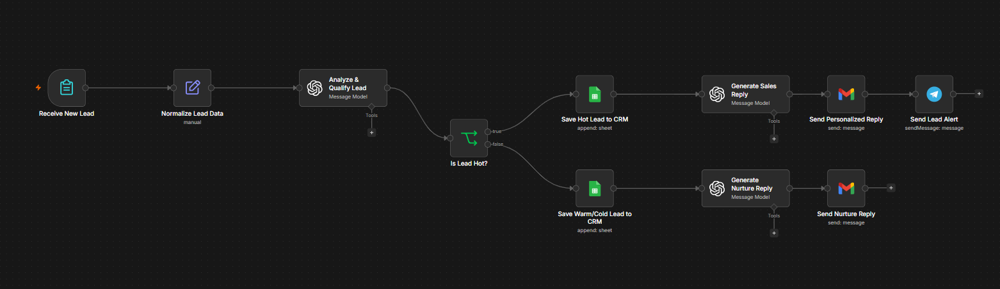

# AI Lead Management & Smart Response System

An n8n workflow that qualifies every new lead with AI, saves it to a Google Sheet, sends a tailored reply, and alerts sales on Telegram when a hot lead comes in.

## Problem

New enquiries arrive through a contact form and land in an inbox. Someone has to read each one, decide how serious it is, copy the details into a spreadsheet and write a reply. Hot leads wait as long as the people who are only browsing.

## Approach

1. **Receive New Lead**: an n8n form collects name, email, company, phone, budget, timeline and message.
2. **Normalize Lead Data**: trims and cleans the fields so every lead has the same shape.
3. **Analyze & Qualify Lead**: OpenAI (gpt-4o-mini) scores the lead from 0 to 100, labels it hot, warm or cold, and writes a short summary, the intent and a recommended next step, as structured JSON.
4. **Is Lead Hot?**: a lead is hot if the AI labels it hot or scores it 70 or more.
5. **Hot leads**: saved to the sheet, a personal reply is drafted with a link to book a call, sent through Gmail, and the sales team gets a Telegram alert with the full lead details.
6. **Warm and cold leads**: saved to the sheet and sent a short, low-pressure nurture email with a useful tip.

## Outcome

Every enquiry gets a fast, relevant reply, and every lead is logged in one sheet with its score, status, intent and next step. Hot leads reach the sales team on Telegram straight away, so the best opportunities are followed up first.

## Tools

n8n · OpenAI · Google Sheets · Gmail · Telegram

## Set it up

1. In n8n, go to **Workflows → Import from file** and choose `ai-lead-management.json`.
2. Make a Google Sheet with the columns in `leads-sheet-template.csv` (first tab), and copy its ID from the URL.
3. Connect your own credentials on the nodes: **OpenAI**, **Google Sheets**, **Gmail** and **Telegram**.
4. Replace the placeholders:
   - `YOUR_GOOGLE_SHEET_ID` in both **Save … to CRM** nodes
   - `YOUR_TELEGRAM_CHAT_ID` in **Send Lead Alert**
   - `https://calendly.com/your-booking-link` in **Generate Sales Reply**
   - `https://your-website.com` in **Generate Nurture Reply**
5. Activate the workflow and open the form URL from the **Receive New Lead** node to send a test lead.

## Notes

- No credentials, API keys, sheet IDs or personal details are included in this repository.
- The scoring rules live in the **Analyze & Qualify Lead** prompt, so you can adjust what counts as hot, warm or cold for your business.

---

Built by **Jeth Divina**, AI Automation Specialist · [LinkedIn](https://www.linkedin.com/in/jethdivina/)
